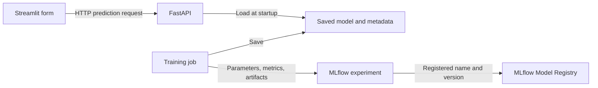

# SIS-3: German Credit ML System

This project extends Practical Task 6 with a Streamlit interface, MLflow experiment tracking, and the MLflow Model Registry. It retains the FastAPI prediction service and Docker deployment from Practical Task 6.

The model is a scikit-learn pipeline with numeric standardization, categorical one-hot encoding, and logistic regression. It uses the bundled German Credit dataset. Age and the combined personal status and sex field are excluded, leaving 18 input features.

## System design



## Run the complete system with Docker

Install Docker Desktop or Docker Engine with Docker Compose. Start Docker and run the following command from this project folder:

```bash
docker compose up --build
```

The first start installs dependencies, starts MLflow, trains and registers the model, and then starts the API and frontend. The `train` service should finish with exit code `0`; it is a one-time training job, not a continuously running server.

| Service | Open in your browser |
| --- | --- |
| Streamlit prediction form | [http://127.0.0.1:8501](http://127.0.0.1:8501) |
| FastAPI Swagger UI | [http://127.0.0.1:8000/docs](http://127.0.0.1:8000/docs) |
| MLflow experiments and model registry | [http://127.0.0.1:5001](http://127.0.0.1:5001) |

All three ports are bound to your computer's loopback interface. Docker services communicate over their Compose network; the frontend uses `http://api:8000`, and training uses `http://mlflow:5000`.

To run in the background, use `docker compose up --build -d`. Inspect startup and training with:

```bash
docker compose ps -a
docker compose logs train
```

## Demonstrate the SIS-3 requirements

1. Open Streamlit, enter the applicant's features, and select **Predict credit risk**. The form sends the request to FastAPI and displays the returned credit-risk class.
2. Open MLflow, select **Model training**, then **Experiments**, and open the **german-credit** experiment. Open its latest successful run to inspect the model and split parameters, evaluation metrics, and saved model artifacts.
3. In MLflow's **Model training** view, open **Model registry** and select **german-credit-logistic-regression**. Its registered version links back to the training run.
4. Open Swagger and check `GET /`, `POST /predict`, and `GET /model-info`. For a prediction, paste `example.json` into the request body.

The API serves the trained `model.joblib` that the training job writes to a shared model volume. Its adjacent `model-info.json` records the MLflow model name, version, run ID, and evaluation metrics. The MLflow registration preserves the connection between a saved model and the experiment that produced it.

### Check the API from a terminal

Run these commands from the project folder:

```bash
curl -fsS http://127.0.0.1:8000/
curl -fsS http://127.0.0.1:8000/predict \
  -H 'Content-Type: application/json' --data-binary @example.json
curl -fsS http://127.0.0.1:8000/model-info
curl -fsS -o /dev/null -w 'Swagger HTTP %{http_code}\n' http://127.0.0.1:8000/docs
```

| Request | Expected response |
| --- | --- |
| `GET /` | `{"message":"ML API is running"}` |
| `POST /predict` with `example.json` | `{"prediction":1,"label":"good_credit_risk"}` |
| `GET /model-info` | Metadata for the model loaded by the API |
| `GET /docs` | Swagger UI, HTTP 200 |

The returned prediction is `1` for good credit risk and `0` for bad credit risk. Unknown categories, out-of-range numeric values, missing fields, and extra fields receive HTTP 422.

### Verify the complete stack

With all services running, execute the integration verifier from the project folder. It uses only Python's standard library:

```bash
python3 scripts/verify_stack.py
```

It checks the API, frontend, and the MLflow experiment and registered model. The default service URLs match the Compose ports listed above.

## Retrain and preserve experiment history

With the Compose system running, create another training run and model version:

```bash
docker compose run --rm train
docker compose restart api
```

The API loads its model when it starts, so restart it after retraining. Refresh the Streamlit page to see the current model metadata.

MLflow's SQLite database and artifacts live in the `mlflow-data` named volume. The trained API model and its metadata live in `model-artifacts`. Stop the system with:

```bash
docker compose down
```

This preserves both volumes, including experiment history and registered model versions, for the next start. The next completed training run creates a new model version.

## Run locally with Python

Use Python 3.13. Run all commands from the project folder and activate the same environment in each terminal:

```bash
python3.13 -m venv .venv
source .venv/bin/activate
python -m pip install -r requirements.txt
```

**Terminal 1: start MLflow.** Keep it running while training and exploring experiments.

```bash
mlflow server \
  --host 127.0.0.1 --port 5001 --workers 1 \
  --backend-store-uri sqlite:///mlflow.db \
  --serve-artifacts \
  --default-artifact-root mlflow-artifacts:/ \
  --artifacts-destination ./mlartifacts
```

**Terminal 2: train and start FastAPI.** Training defaults to the local MLflow server at `http://127.0.0.1:5001`.

```bash
source .venv/bin/activate
python train.py
python -m uvicorn main:app --host 127.0.0.1 --port 8000
```

**Terminal 3: start the frontend.** It defaults to the local API at `http://127.0.0.1:8000`.

```bash
source .venv/bin/activate
python -m streamlit run frontend.py \
  --server.address 127.0.0.1 --server.port 8501 \
  --browser.gatherUsageStats false
```

Use the same browser URLs and API checks as for Docker. After local retraining, restart Uvicorn to load the new model.

### Configuration

| Variable | Default for local execution | Purpose |
| --- | --- | --- |
| `MLFLOW_TRACKING_URI` | `http://127.0.0.1:5001` | Tracking server used by training |
| `MLFLOW_EXPERIMENT_NAME` | `german-credit` | Experiment containing training runs |
| `MLFLOW_MODEL_NAME` | `german-credit-logistic-regression` | Registered model name |
| `MODEL_PATH` | `model.joblib` beside the Python files | Output file for training and model loaded by the API |
| `API_URL` | `http://127.0.0.1:8000` | API used by Streamlit |

## Model evaluation

The dataset is split into 800 training rows and 200 test rows with stratification and random seed 42. The preprocessing pipeline is fitted only on the training partition.

| Metric | Expected value |
| --- | ---: |
| Accuracy | 0.700 |
| Macro F1 | 0.639 |
| Macro precision | 0.641 |
| Macro recall | 0.638 |

F1, precision, and recall use macro averaging: each metric is calculated for each class, then the two class scores are averaged with equal weight. The majority-class baseline also has 70% accuracy. This project demonstrates model deployment and lifecycle tracking; the evaluation results are recorded rather than presented as an improvement over that baseline.

## Project files

| File | Role |
| --- | --- |
| `train.py` | Train, evaluate, log artifacts, and register a model version |
| `main.py` | FastAPI health, prediction, and model metadata endpoints |
| `schemas.py` | Shared input schema and validation |
| `frontend.py` | Streamlit form that calls the API |
| `model.joblib` | Bundled trained pipeline for standalone API use |
| `model-info.json` | Generated MLflow metadata, created during training |
| `requirements.txt` | Pinned Python dependencies |
| `Dockerfile` | Shared Python image for the services |
| `compose.yaml` | MLflow, training, API, frontend, and persistent volumes |
| `scripts/verify_stack.py` | Integration checks for the running system |
| `example.json` | A complete prediction request |
| `german.data` | Training dataset |

## Dataset

Hofmann, H. (1994). *Statlog (German Credit Data)*. UCI Machine Learning Repository. The bundled `german.data` contains the original dataset and is provided under CC BY 4.0. [Dataset and license](https://doi.org/10.24432/C5NC77).
